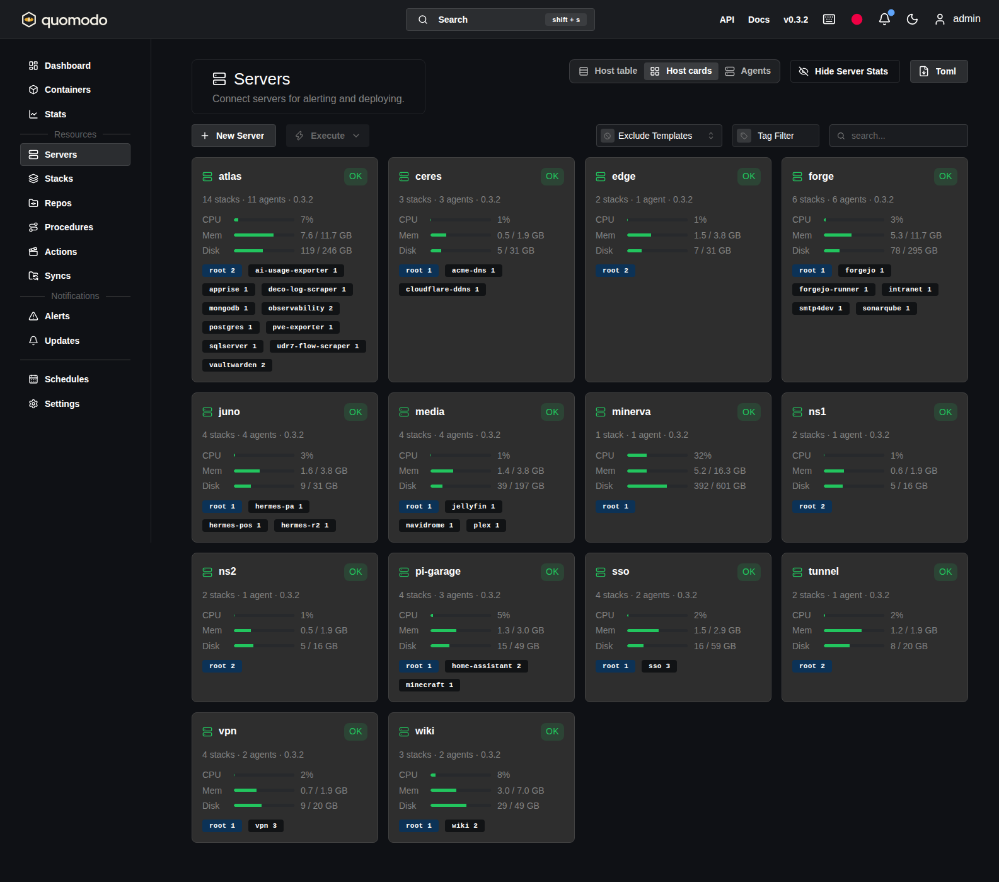

# Install

Quomodo has two parts. Core (API, UI, mongo) runs as a root podman pod on one
host. The agent runs on every host that deploys stacks, including the Core
host if it deploys stacks too, and dials out to Core. As root it deploys
rootful quadlets; run as a user, it deploys that user's rootless quadlets
([Rootless agent](#rootless-agent)).

## Requirements

- Linux with systemd and podman 5.0 or newer on every host. Quadlet `.pod`
  and `.build` units need 5.0.
- `git` on every agent host.
- TLS in front of Core. Agents only connect over `wss://` and refuse to
  start with a `ws://` or `http://` address: the key handshake between agent
  and Core authenticates both ends but does not encrypt the session, and Core
  sends resolved secrets over it. Either Core serves TLS itself or a reverse
  proxy does ([TLS](#tls)). See [SECURITY.md](../SECURITY.md).

## Core

The files in [`example/quomodo-core`](../example/quomodo-core) are a working
Core pod: Core plus mongo, with the volumes they need. The pod runs in its own
user namespace, so the Core host needs the same `containers` subordinate id
range as an agent host ([Agent](#agent), step 2).

1. Copy them to the host and edit `quomodo-core.container`:
   - `KOMODO_HOST`: the URL users open Core on.
   - `Image=`: the image and tag to run. Releases are published to
     `ghcr.io/loganrupe/quomodo:<tag>` and `:latest`, for amd64 and arm64.
     podman pulls the one matching the host. The example's `mongo:8` needs
     an ARMv8.2 CPU on arm64: a Raspberry Pi 5 runs it, a Pi 4 does not.
   - Login: local admin is on by default. Uncomment the OIDC block to add an
     OIDC provider, and create its client secret in step 2.
   - TLS: uncomment that block if Core serves TLS itself rather than sitting
     behind a proxy ([TLS](#tls)).
   - Secrets provider: uncomment that block if stacks will read secrets from
     a vault ([secrets.md](secrets.md)).

   Every option in [`config/core.config.toml`](../config/core.config.toml)
   can be set as an `Environment=` line. The file lists the variable name
   for each one.

   In `quomodo.pod`, change `PublishPort=` if Core should listen on one
   address only.

2. Create the bootstrap secrets as root podman secrets. Nothing with a secret
   value goes under `/etc`:

   ```sh
   openssl rand -base64 32 | tr -d '\n' | sudo podman secret create quomodo-mongo-password -
   openssl rand -base64 32 | tr -d '\n' | sudo podman secret create quomodo-jwt-secret -
   openssl rand -base64 24 | tr -d '\n' | sudo podman secret create quomodo-admin-password -
   ```

   The admin password is only read on the first start, when the database has
   no users. To log in, read it once with
   `sudo podman secret inspect --showsecret quomodo-admin-password`,
   then change it in the UI.

3. Install and start:

   ```sh
   sudo mkdir -p /etc/containers/systemd/quomodo
   sudo cp example/quomodo-core/* /etc/containers/systemd/quomodo/
   sudo systemctl daemon-reload
   sudo systemctl start quomodo-pod.service
   ```

   `curl http://localhost:9120/version` (`https://` with TLS on Core) prints
   the version once Core is up.
   Core writes its key pair to the `quomodo-keys` volume on first start.
   Settings in the UI shows its public key.

`AutoUpdate=registry` lets `podman auto-update` (or its systemd timer) pull a
new `:latest` and restart Core. Pin a tag instead if you want upgrades to be
a deliberate edit.

Keep `RunInit=true` in `quomodo-core.container`. Every git fetch leaves a
detached `git maintenance` behind, and without an init as PID 1 nothing
reaps it when it exits. The zombies fill the container's pids limit (2048)
in about a day on a busy install, and then every sync fails with
`cannot fork()` or `'git' is not installed or available on $PATH`. An
install made from an older example: add the line, then
`sudo systemctl daemon-reload && sudo systemctl restart quomodo-core.service`.

### TLS

Agents verify Core's certificate against the system roots, or against the
CA in `core_tls_ca_file` if you set one. There is no way to skip
verification: without it, anyone in the path can relay the key handshake
and read everything after it.

Pick one:

- **A reverse proxy** (Caddy, Traefik, nginx) with a public certificate,
  forwarding to Core's plain HTTP on 9120. It must pass websocket upgrades
  for `/ws/` and forward the `Host` header unchanged. The agent binds its
  handshake to the host name it dialled, so a rewritten `Host` fails the
  login with `401 Unauthorized`. Bind Core's `PublishPort=` to an address
  only the proxy reaches, so nothing talks to it in the clear.
- **Core serves TLS itself.** Set `KOMODO_SSL_ENABLED=true` and point
  `KOMODO_SSL_CERT_FILE` / `KOMODO_SSL_KEY_FILE` at a full chain and its key.
  The example container has this block commented out: it mounts a host
  directory read-only at `/config/ssl`. The certificate must name the host
  or IP the agents dial. For a private CA, copy the CA certificate to each
  agent and set `core_tls_ca_file`.

### Certificate renewal

Core checks the cert and key files for changes every 5 minutes
(`ssl_reload_interval`) and loads a renewed pair without a restart.
Connected agents keep their sessions; new connections get the new
certificate. A pair that fails to load, such as a renewal caught half
written, leaves the current certificate in place and is tried again on the
next check.

So renewal is your ACME client (lego, certbot, acme.sh, step-ca) writing
new files into the mounted directory. Two rules:

- Mount the directory, not the two files. ACME clients and rsync replace a
  file by renaming a new one over it, and a single-file bind mount keeps
  pointing at the old copy.
- The container's root has to be able to read both files. In the example
  pod that is host uid 2147483647, not root: make the directory and files
  owned by that uid (`chown -R 2147483647:2147483647`), or readable by
  others.

If the certificate expires anyway, agents that are connected stay
connected, but none can reconnect: each retries every 5 seconds and logs
the certificate error, and its Server shows as not OK. Running containers
are unaffected. Once Core serves a valid certificate the agents reconnect
on their own. Alert on expiry, for example with the blackbox exporter's
`probe_ssl_earliest_cert_expiry`.

## Agent

Repeat on every host that deploys stacks.

1. Install the binary. Releases attach `quomodo-agent-x86_64` and
   `quomodo-agent-aarch64`, each with its `.sha256`. Both need glibc 2.36
   or newer: Debian 12, Ubuntu 24.04 and Raspberry Pi OS bookworm have it,
   Ubuntu 22.04 does not. `uname -m` prints the architecture to pick:

   ```sh
   VERSION=v0.1.1   # the release tag to install
   ASSET=quomodo-agent-$(uname -m)
   cd /tmp
   curl -fLO https://github.com/LoganRupe/quomodo/releases/download/$VERSION/$ASSET
   curl -fLO https://github.com/LoganRupe/quomodo/releases/download/$VERSION/$ASSET.sha256
   sha256sum -c $ASSET.sha256
   sudo install -m 0755 $ASSET /usr/local/bin/quomodo-agent
   ```

2. Give podman's `containers` user a subordinate id range. The agent cuts a
   fixed 65536-id slice out of it for every pod and standalone container
   ([stacks.md](stacks.md#user-namespaces)). A deploy fails without it.

   ```sh
   grep -q '^containers:' /etc/subuid || echo 'containers:2147483647:2147483648' | sudo tee -a /etc/subuid
   grep -q '^containers:' /etc/subgid || echo 'containers:2147483647:2147483648' | sudo tee -a /etc/subgid
   ```

3. Write `/etc/quomodo/config.toml`. Two fields are required; the rest have
   defaults, documented in [`config/agent.config.toml`](../config/agent.config.toml):

   ```toml
   core_addresses = ["wss://quomodo.example.com"]
   connect_as = "web-01"   # the Server name on Core
   # core_tls_ca_file = "/etc/quomodo/ca.pem"   # only for a private CA
   ```

4. Install the unit as `/etc/systemd/system/quomodo-agent.service`:

   ```ini
   [Unit]
   Description=Quomodo agent
   After=network-online.target
   Wants=network-online.target

   [Service]
   ExecStart=/usr/local/bin/quomodo-agent --config-path /etc/quomodo/config.toml
   Restart=always
   RestartSec=5

   [Install]
   WantedBy=multi-user.target
   ```

   If Core is only reachable over a VPN, add its daemon to `After=` (for
   example `tailscaled.service`).

5. Start it and print its public key:

   ```sh
   sudo systemctl daemon-reload
   sudo systemctl enable --now quomodo-agent
   sudo quomodo-agent --config-path /etc/quomodo/config.toml public-key
   ```

   The agent writes its private key to `/etc/quomodo/keys/agent.key` on first
   start. The connection fails until step 6.

6. Register the host on Core. Either:
   - create a Server named after `connect_as` (UI or ResourceSync), and paste
     the agent's public key into its config; or
   - create an onboarding key under Settings, save its private key on the
     host and set `onboarding_key = "file:/etc/quomodo/keys/onboarding.key"`.
     The agent creates its own Server on first connect.

   The Server shows `Ok` once the agent is in. On that first connection the
   agent writes Core's public key to `/etc/quomodo/keys/core.pub` and refuses
   any other Core from then on. To pin it up front instead, copy the key from
   Settings into that file before step 5.

### Files the agent owns

| Path | What it is |
| --- | --- |
| `/etc/quomodo/config.toml` | Agent config |
| `/etc/quomodo/keys/agent.key` | Agent private key |
| `/etc/quomodo/keys/core.pub` | Core's pinned public key |
| `/var/lib/quomodo/repos/` | Repo clones |
| `/var/lib/quomodo/state/` | Deploy state per stack |
| `/var/lib/quomodo/idmap.json` | The user namespace slice each unit runs on |
| `/etc/containers/systemd/<stack>/` | Installed stacks |

Back up `idmap.json` with the host. If it is lost, the next deploy hands out
new slices and every volume's files belong to the wrong uids.

### Rootless agent

An agent started as any user but root deploys that user's rootless quadlets:
units go to `~/.config/containers/systemd/<stack>/`, systemd is driven with
`systemctl --user`, and podman containers, images and secrets are the
user's own. No root process holds the Core connection, so a compromised Core
reaches that user and not the host. Each such agent is its own Server on
Core, shown as `rootless (<user>)`. A host can run a root agent and any
number of user agents side by side, each with its own `connect_as`.

The Servers page groups agents by the hostname they report. Host table shows
one row per machine, with its stats once; click a host to list its agents and
the stacks each one runs. Host cards shows the same as a card per machine.
Agents shows one row per agent. A disconnected agent stays under the host it
last reported.



Give each stack, or each group of stacks that trust each other, its own
service user rather than a person's account: a compromised container then
reaches that user's files and stacks only. Make it a regular user with a real
home and no login shell:

```sh
sudo useradd --create-home --home-dir /var/lib/web-app --shell /usr/sbin/nologin web-app
```

Not `useradd --system`: journald keeps a separate journal only for uids of
1000 and up, so a system user's units log to the system journal, which the
user cannot read, and the agent's `journalctl --user` comes back empty when a
unit fails. A system user also gets no subordinate ids.

The steps below use the user `alice`. Run the root ones once per user.

1. Install the binary as in [Agent](#agent) step 1.

2. As root, turn on lingering, so alice's systemd starts at boot and her
   stacks keep running with nobody logged in. The agent checks for it and
   refuses to deploy without it.

   ```sh
   sudo loginctl enable-linger alice
   ```

3. As root, give alice subordinate ids for her stacks. The agent cuts the
   same fixed 65536-id slices out of her own range that a root agent cuts
   out of `containers` ([stacks.md](stacks.md#user-namespaces)). `useradd`
   usually gives a user 65536 ids, which is one slice. Add a range of
   4194304 ids (64 slices) after it. Pick a start no other entry in
   `/etc/subuid` or `/etc/subgid` overlaps:

   ```sh
   sudo usermod --add-subuids 1000000-5194303 --add-subgids 1000000-5194303 alice
   ```

   Only ever add ranges. Slices are laid out over alice's ranges in file
   order, so removing or moving one moves her slices, and the files in her
   volumes end up owned by the wrong ids.

4. A rootless agent cannot publish host ports below
   `net.ipv4.ip_unprivileged_port_start`, usually 1024, and a deploy whose
   `PublishPort=` lines try fails before anything is written. Use higher
   ports, put a root reverse proxy in front, or lower the limit host-wide in
   `/etc/sysctl.d/`. A `Network=host` container binds whatever port its
   program picks, which the agent cannot see: one below the limit fails when
   the unit starts, not at deploy.

   Rootless containers on a `.network` see every client as an address of
   that network (`10.89.x.x`), not the real source address. On podman's
   default rootless network (pasta, no `Network=` line) or `Network=host`
   they see the real one. Anything that logs, limits or bans by client
   address, such as a reverse proxy, CrowdSec or a syslog receiver, belongs
   on one of those, or on the root agent.

5. As alice, write `~/.config/quomodo/config.toml` as in [Agent](#agent)
   step 3. Leave out `config_directory`, `root_directory` and
   `quadlet_dir`: run as alice they default to `~/.config/quomodo`,
   `~/.local/share/quomodo` and `~/.config/containers/systemd`.

6. As alice, install the unit as
   `~/.config/systemd/user/quomodo-agent.service`:

   ```ini
   [Unit]
   Description=Quomodo agent (rootless)

   [Service]
   ExecStart=/usr/local/bin/quomodo-agent --config-path %h/.config/quomodo/config.toml
   Restart=always
   RestartSec=5

   [Install]
   WantedBy=default.target
   ```

   ```sh
   systemctl --user daemon-reload
   systemctl --user enable --now quomodo-agent
   quomodo-agent --config-path ~/.config/quomodo/config.toml public-key
   ```

   `systemctl --user` needs alice's `XDG_RUNTIME_DIR`, and the agent finds
   its directories through `$HOME`. A login shell as alice sets both. From
   root, set them yourself; this also works for a service user with no
   login shell:

   ```sh
   sudo runuser -u alice -- env HOME=/home/alice XDG_RUNTIME_DIR=/run/user/$(id -u alice) \
     systemctl --user enable --now quomodo-agent
   ```

7. Register the Server as in [Agent](#agent) step 6.

A user's systemd has no `multi-user.target`, so a rootless agent installs
units with `WantedBy=multi-user.target` or `graphical.target` as
`WantedBy=default.target`. The same stack files then start at boot under
either agent. A user unit cannot order itself after a system unit such as
`tailscaled.service`; give units that need the network `Restart=` instead.

Alice's agent keeps the files in the table above under her home instead:
the config and keys in `~/.config/quomodo/`, repos, state and `idmap.json`
in `~/.local/share/quomodo/`. Back up her `idmap.json` too.

## First stack

1. If the stack's repo is private, add a git account under Settings, or a
   `[[git_provider]]` block in Core's or the agent's config.
2. Create a Stack pointing at a directory of quadlet files. In a ResourceSync
   TOML file:

   ```toml
   [[stack]]
   name = "app"
   [stack.config]
   server_id = "web-01"
   git_provider = "github.com"
   git_account = "deploy-bot"      # empty for a public repo
   repo = "me/infra"
   branch = "main"
   run_directory = "stacks/app"
   secrets_collection = "app"      # only if the files use secrets
   auto_pull = true
   ```

3. Deploy it from the UI, or call `DeployStack`.

[stacks.md](stacks.md) covers what goes in the directory.

## Webhooks

Stacks, Repos, ResourceSyncs, Procedures and Actions each show their webhook
URL in the UI. Core has a GitHub listener (`/listener/github/...`, HMAC-SHA256
signature) and a GitLab listener (`/listener/gitlab/...`). Forgejo and Gitea
send GitHub-format webhooks, so point them at the GitHub URL. Set
`KOMODO_WEBHOOK_SECRET`, or a per-resource secret, to the same value on the
git side.
